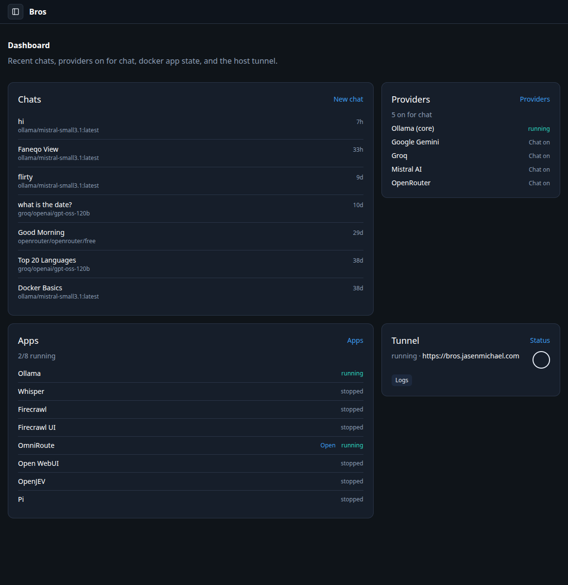
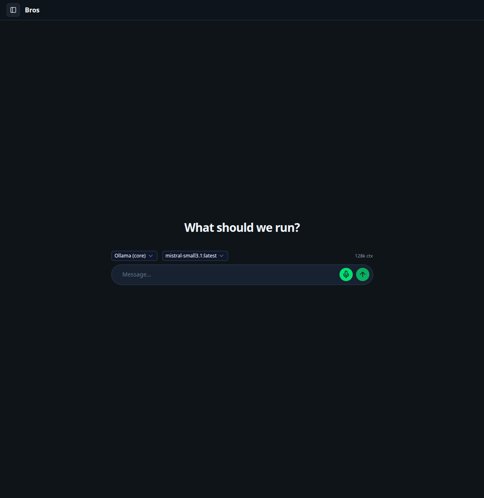
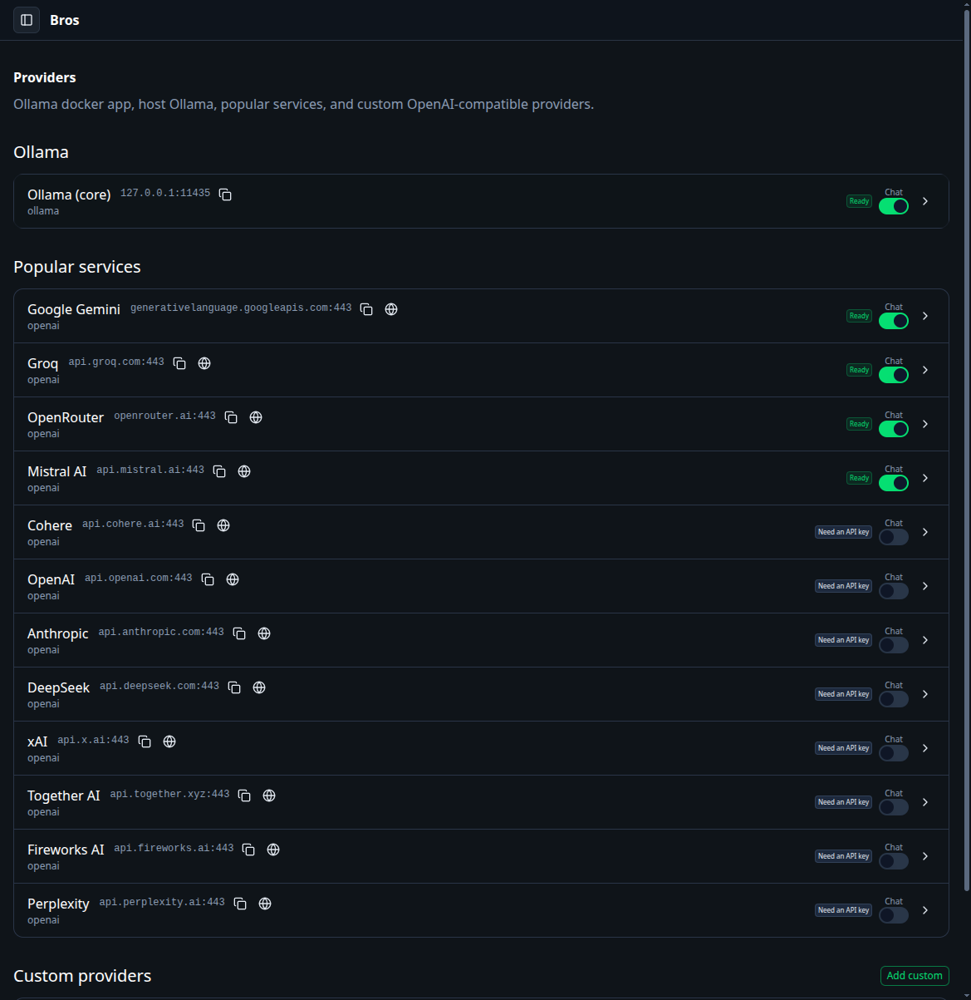
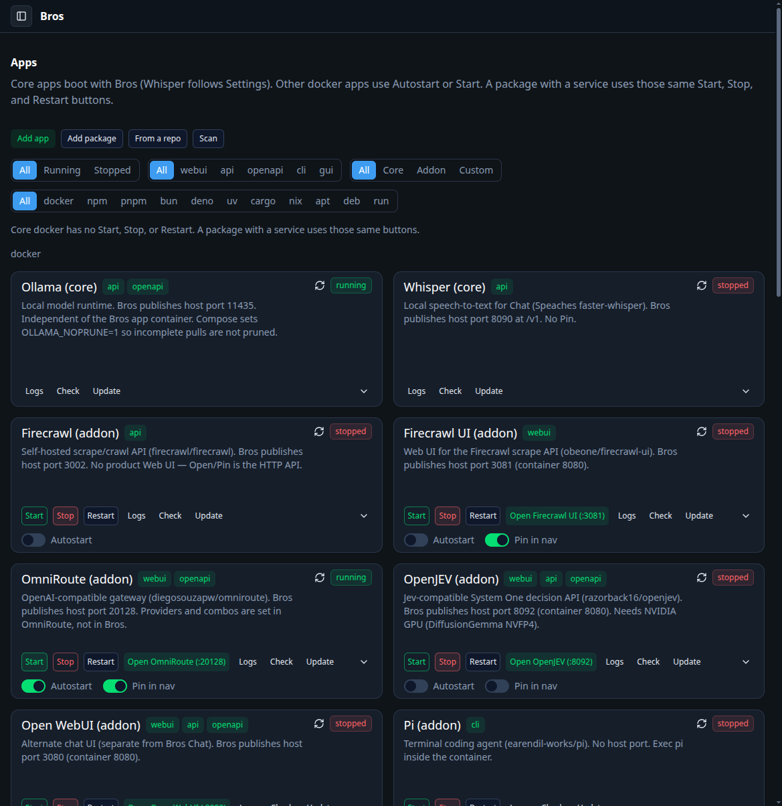
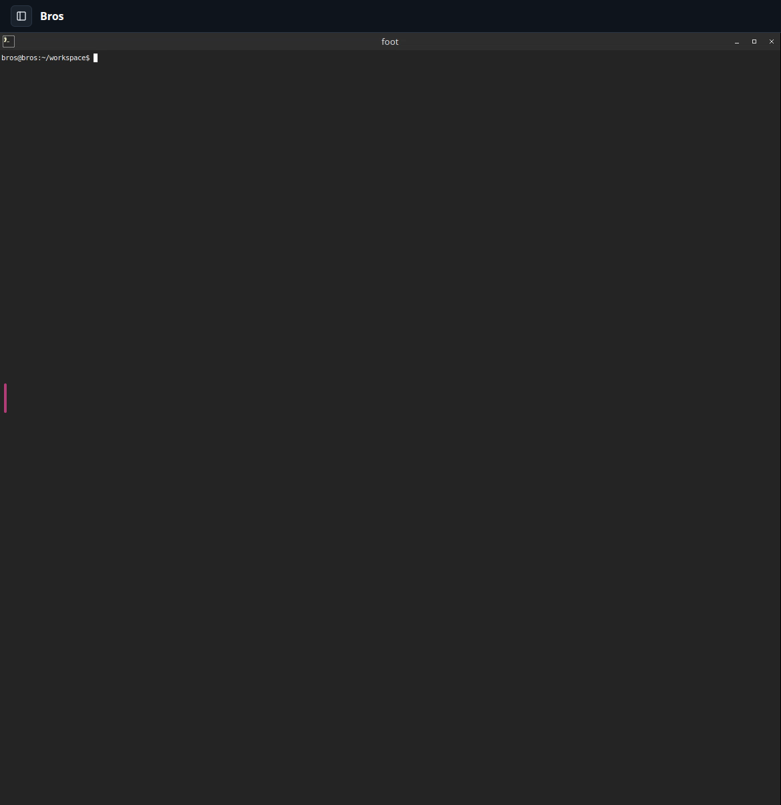

# Bros

**B**oxed **R**untime **O**rchestration **S**ystem — a Docker-isolated local AI control plane. Chat, providers, apps, and a desktop in the browser on one host.

<p align="center">
  <a href="https://jasenmichael.github.io/bros/"><strong>Docs</strong></a> &middot;
  <a href="docs/install.md"><strong>Install</strong></a> &middot;
  <a href="docs/development.md"><strong>Development</strong></a> &middot;
  <a href="https://github.com/jasenmichael/bros"><strong>GitHub</strong></a>
</p>

<p align="center">
  <a href="https://github.com/jasenmichael/bros/blob/main/LICENSE"></a>
  <a href="https://github.com/jasenmichael/bros/stargazers"></a>
</p>

<p align="center">
  
</p>

## What Bros is

Three parts that stay together:

- **CLI** `bros` — default action is start. Docker for the stack.
- **Browser app** — Chat, Providers, Apps, Agents, Status, Settings, plus `/desktop` and `/terminal`.
- **Docs** — same `docs/` in the app and on [GitHub Pages](https://jasenmichael.github.io/bros/).

Local models via Ollama, cloud keys on Popular services, package and docker apps from one store, a Wayland desktop in the browser. Optional host Cloudflare tunnel for a public URL.

## Features

| | | |
| --- | --- | --- |
| **Chat** — Provider then model. Stop aborts the stream. Mic uses Whisper when enabled. | **Providers** — Ollama (core + host), fourteen Popular services, custom OpenAI-compat. | **Apps** — Core, addon, custom, and package installs on one `/apps` page. |
| **Desktop** — One Selkies stream at `/desktop`. GUI apps open in that session. | **Agents** — Job board over Workspace repos. Preflight, implement, PR gate. | **Tunnel** — Host `cloudflared` when `public_url` is set in `bros.yml`. |

Internal Ollama model `bros` titles chats. Not in the Chat picker. See [docs/apps/ollama.md](docs/apps/ollama.md).

## Screenshots

<details>
<summary><b>Chat, Providers, Apps, Desktop</b></summary>

| Page | Screenshot |
| --- | --- |
| **Chat** |  |
| **Providers** |  |
| **Apps** |  |
| **Desktop** |  |

</details>

## Quickstart

Needs Docker. Does not need git, cargo, or Node for a release install.

```bash
curl -fsSL https://jasenmichael.github.io/bros/install.sh | bash
bros
```

Open [http://127.0.0.1:3055](http://127.0.0.1:3055). Full install (source, systemd, overrides): [docs/install.md](docs/install.md). Getting started: [docs/getting-started.md](docs/getting-started.md).

Checkout / hot-reload contributors: [docs/development.md](docs/development.md).

## Agent skills

```bash
npx skills@latest add jasenmichael/bros
```

Coding-agent skills in [`skills/`](skills/). Not Chat `rules` / `personality` under `lib/skills/`.

## Docs

- [Getting started](docs/getting-started.md) · [Install](docs/install.md) · [Development](docs/development.md)
- [Apps](docs/apps.md) · [CLI](docs/cli.md) · [API](docs/api.md) · [Configuration](docs/configuration.md)
- Site: [https://jasenmichael.github.io/bros/](https://jasenmichael.github.io/bros/)

[SPEC.md](SPEC.md) · [STACK.md](STACK.md) · [PLAN.md](PLAN.md) · [DESIGN.md](DESIGN.md)
